<p align="center">
  
</p>

# job-hunt-copilot

Your job search copilot: it finds the roles, fills the forms and drafts the outreach, so you keep your evenings for getting better.

## Why I built this

Looking for a job while working full time is a second job that nobody pays you for.

I'm a backend engineer. When I started looking for my next role, my evenings went into the same routine: open a job board, read twenty postings to find three that fit, fill out a form that asks for the same notice period, salary and years of experience as the last one, then go to LinkedIn and look for someone on the team to write to, so the application doesn't disappear into a pile.

That took two to three hours a day. The hours weren't the worst part. Three hours of tabs, forms and copy-paste leaves nothing in the tank. The time I wanted to spend getting better, learning a new stack or preparing for interviews, went into paperwork. The search was eating the skills that make the search succeed.

Many engineers are being laid off right now. They're doing the same routine without a salary, with a deadline, and with more pressure on every application. For them, three hours a day isn't an inconvenience. It's the difference between preparing well for an interview and walking in exhausted.

So I started building job-hunt-copilot. It does the repetitive part and leaves the decisions to you. It searches job boards, reads every posting and ranks them against your profile. It fills applications from one answer bank, so you answer each question once, ever. It finds the right engineers, managers and recruiters for each role and drafts a short, specific message for each one. It never sends anything on its own. You review, and you press Submit and Send.

It's open source because the people who need it most have just lost their income. A tool that saves job seekers hours shouldn't come with a subscription.

I build it with Claude Code. Claude drives the browser, reads the job descriptions, and writes answers only from facts you've given it. With more people using it, the answer bank and job-board support get better for everyone. My goal is simple: give job seekers their evenings back, so they can spend them getting better at what they do.

## What it does

- **Find** (`/find`): Searches configured job portals, scores and ranks listings against your target profile, filters out low-signal postings, and writes structured research notes for top matches.
- **Apply** (`/apply`): Drives browser form filling with Claude in Chrome using answers from your local answer bank. It fills out repetitive form fields, explains its choices, and stops for your review.
- **Reach** (`/reach`): Identifies relevant engineers, hiring managers, and recruiters for applied roles, respecting strict daily caps, and drafts personalized outreach messages tailored to each contact.

## What it never does

- Never sends messages or connection requests.
- Never submits without you.
- Never types passwords.
- Never solves CAPTCHAs.

## Safer note

> **Safer note:** Automating LinkedIn, even read-only, breaks LinkedIn's terms of service and can
> get your account restricted or banned. The same goes for other job sites. Use these features at
> your own risk, keep the daily limits low, and stop at the first warning. This project never
> sends messages or connection requests for you; you press Send.

## Quick start

### Prerequisites
- Python 3.11+
- [bun](https://bun.sh/)
- Claude Code with Claude in Chrome

### Installation
1. Clone the repository:
   ```bash
   git clone https://github.com/abhishekk7r/job-hunt-copilot.git
   cd job-hunt-copilot
   ```

2. Create a virtual environment and install dependencies:
   ```bash
   python3 -m venv .venv
   source .venv/bin/activate
   pip install -r requirements.txt
   ```

3. Configure your local settings and profile:
   ```bash
   cp config/example.toml config/local.toml
   cp config/applicant_facts.example.md config/applicant_facts.local.md
   ```

4. Run the test suite:
   ```bash
   make test
   ```

5. Run the commands in Claude Code:
   - `/find` — Discover and rank matching roles
   - `/apply` — Guided application form filling
   - `/reach` — Discover contacts and draft outreach

## Privacy

Personal data lives only in git-ignored files (`config/local.toml`, `config/*.local.*`, etc.) and is never tracked in git.

The repository includes a PII guard (`tools/check_pii.py`) that checks against a local pattern blocklist before tests pass.

To install the git pre-commit hook:
```bash
cp tools/pre-commit-pii .git/hooks/pre-commit
chmod +x .git/hooks/pre-commit
```

## Credits & License

- Credits: upstream [ai-job-search](https://github.com/ai-job-search-dev/ai-job-search) by Mads Lorentzen (MIT).
- License: [MIT](LICENSE).
