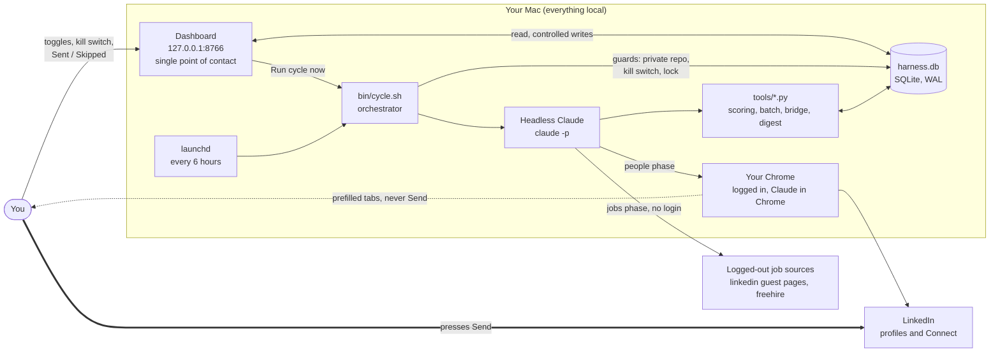
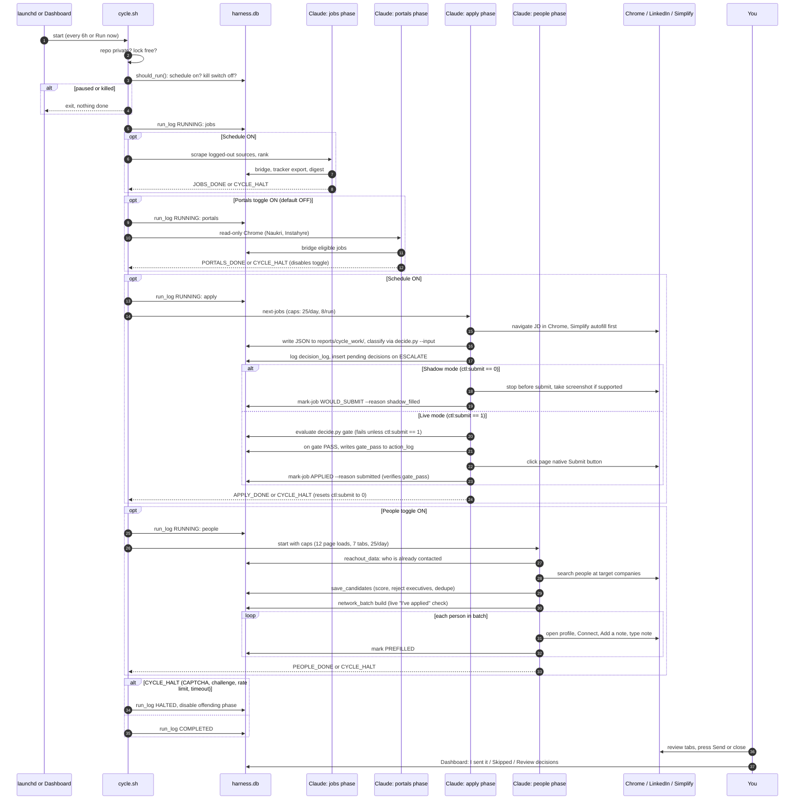
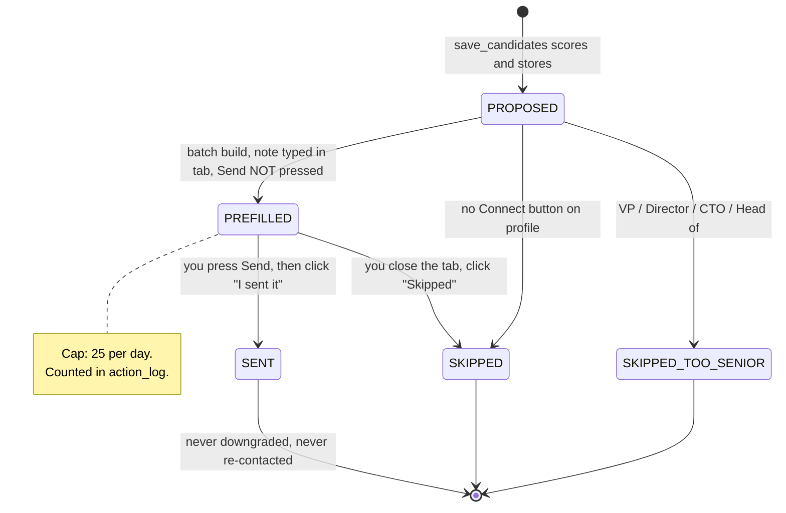
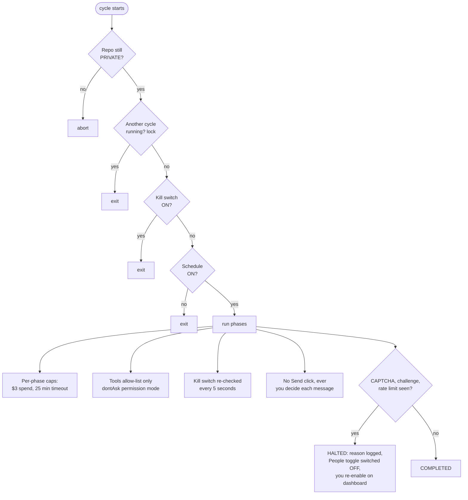
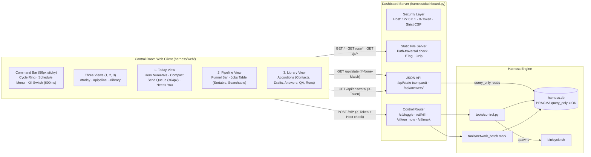

# High-level design

Diagrams are Mermaid; GitHub (private repo), VS Code and Obsidian render them.

## 1. System overview

## 2. The 6-hour cycle

## 3. Data model

```mermaid
erDiagram
    jobs ||--o{ contacts : "job_id"
    jobs ||--o{ outreach_queue : "job_id"
    jobs ||--o{ outreach_email_drafts : "company"
    jobs {
        int id PK
        text company
        text role
        text job_url UK
        text status "TO_APPLY, APPLIED, BLOCKED_USER, RANKED_OUT"
        text blocker_note
        text recruiter_name
        real rank_score
        int salary_lpa
        text source
    }
    contacts {
        int id PK
        int job_id FK
        text name
        text title
        text profile_url UK
        text current_company
        real score
        text kind
        text status "PROPOSED, PREFILLED, SENT, SKIPPED, JOB_CONTACT"
        text note_text "max 300 chars"
    }
    outreach_queue {
        int id PK
        int job_id FK
        text channel
        text rendered_message
        text approval_status
    }
    outreach_email_drafts {
        int id PK
        text company
        text contact_name
        text to_email
        text subject
        text body
        text status
    }
    screening_qa {
        text question_key PK
        text answer
    }
    app_story_answers {
        int id PK
        text application
        text question
        text answer
        text status "DRAFT_NOT_SUBMITTED, SUBMITTED"
    }
    open_items {
        int id PK
        text area
        text item
        text status
    }
    gmail_drafts_snapshot {
        int id PK
        text account
        text draft_message_id UK
        text subject
    }
    run_log {
        int id PK
        text run_id
        text mode "cycle"
        text status "RUNNING, COMPLETED, HALTED"
        text halted_reason
    }
    action_log {
        int id PK
        text ts
        text action "network_prefill"
        text target
        text result
    }
    kill_switch {
        int id PK
        int on
        text reason
    }
    budgets {
        text key PK "ctl:schedule, ctl:portals, ctl:people, ctl:submit"
        int val
    }
    agent_locks {
        text resource_id PK
        text locked_by
        text expires_at
    }
```

## 4. Contact lifecycle

## 5. Safety and control layers

## 6. Dashboard control surface: "Control Room" (http://127.0.0.1:8766)

The web dashboard is the single point of contact for the entire system: monitoring the 6-hour cycle, toggling automation phases, and deciding outbound contact messages.

### Architectural Principles
1. **Zero Runtime Network Calls:** All fonts (Instrument Serif, Geist, Geist Mono) and assets are served locally from `harness/web/`. Works 100% offline with Wi-Fi disabled.
2. **Strict Security Model:** Binds strictly to `127.0.0.1`. Host header checks reject DNS-rebinding attacks. Sensitive answers are omitted from bulk payloads and only revealed on-demand via authenticated `/api/answers/{id}` with `X-Token`. Strict Content Security Policy (`default-src 'none'; script-src 'self'; ...`).
3. **Safe DOM Manipulation:** Zero `innerHTML` on untrusted database content; all elements are constructed using safe DOM methods (`createElement`, `textContent`).
4. **Safety Windows & In-Page Confirmations:** Marking a prefilled contact as `SENT` or `SKIPPED` invokes a 6-second in-page undo delay before the irreversible POST is dispatched. Destructive kill-switch activation requires a 600ms hold-to-confirm press.
5. **High Performance & Low Latency:** Initial paint transfer sizes are strictly budgeted (HTML $\le 8\text{ KB}$, CSS $\le 24\text{ KB}$, JS $\le 45\text{ KB}$ gzip). Polling every 5s on `/api/state` uses ETag/304 validation and pauses when the document is hidden.
