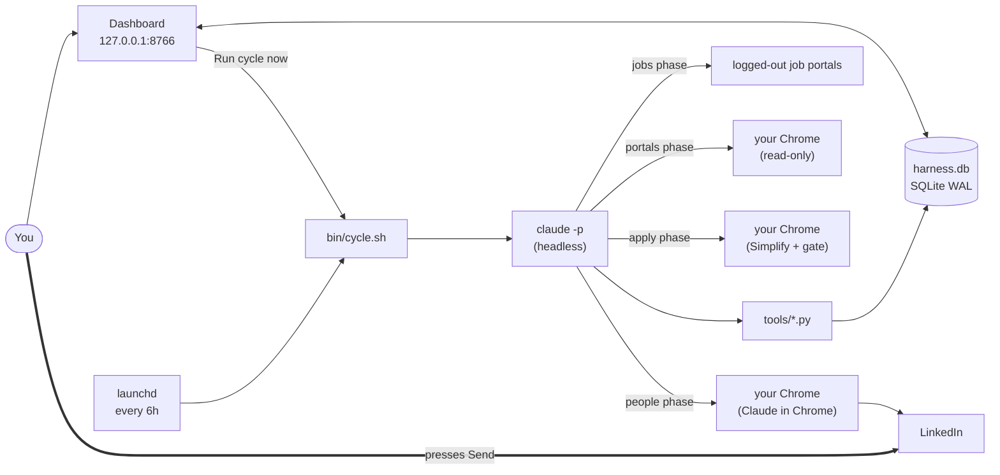
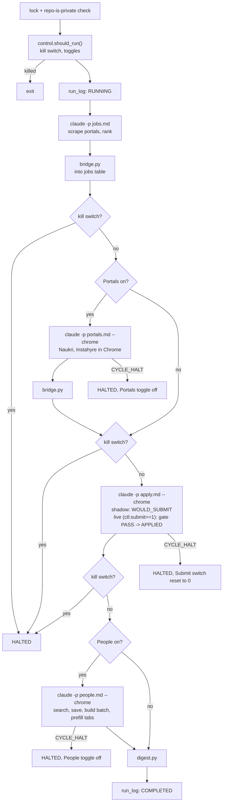

# Job Search Engine: how it works

A local system that finds jobs, finds the right people at target companies, and prepares a LinkedIn note for each. It never sends or submits anything: you press Send. Runs only on your Mac. Repo is private.

## 1. Architecture

| Layer | Implementation |
|---|---|
| Orchestration | `bin/cycle.sh` (bash), PID lock in `/tmp/jobsearch_cycle.lock` |
| Schedule | launchd: `StartInterval 21600`, `RunAtLoad false`. Dashboard agent is `KeepAlive` |
| AI worker | `claude -p <prompt> --permission-mode dontAsk --allowedTools <list> --max-budget-usd 3`. Prompts in `docs/cycle_prompts/` |
| Browser | Claude in Chrome in your own Chrome. Never Playwright/Selenium/Puppeteer or the `linkedin` MCP (those got accounts locked; `tests/test_no_bot_browsers.py` enforces it) |
| Job sources | Logged-out TypeScript CLIs run with Bun (`.agents/skills/*-search/cli`) |
| Logic | Python in `tools/` (scoring, ranking, batching, control, policy engine `decide.py`) |
| State | One SQLite DB `harness.db` (schema in `schema.sql` + migrations) |
| UI | Python `ThreadingHTTPServer` + static HTML/CSS/ES modules, no framework, no external requests, real-time status line |
| Agent API | FastMCP server `harness/server.py` (locks, call budget, jobs, answers) |
| Tests | pytest + `bun test`, `make test` |

## 2. What "Run cycle now" does

**Click.** `main.js` sends `POST /ctl/run_now` with `X-Token`. The server checks the Host header and token, then `control.request_run_now()`: if the lock PID is alive it returns `started:false`, else it spawns `cycle.sh` detached with `CYCLE_TRIGGER=dashboard` (log: `/tmp/jobsearch_cycle.log`).

**Cycle** (`bin/cycle.sh`):

1. **Gate.** Exits if another cycle holds the lock or the repo isn't private. `should_run()` reads `budgets` keys `ctl:schedule`, `ctl:portals`, `ctl:people`, and the kill switch. A dashboard click skips only the schedule toggle.
2. **Jobs phase.** Claude follows `jobs.md`: scrape logged-out portals (LinkedIn, Freehire, Wellfound, max 40 page loads), query planner, score inline and rank with `rank_state.py`. Then `bridge.py` upserts ranked jobs into `jobs`, never downgrading `APPLIED` or `BLOCKED_USER`. Allowed tools are Read/Grep/Glob/Write/Edit/Skill/WebSearch plus named CLI commands only.
3. **Portals phase (default OFF).** Claude with `--chrome` follows `portals.md`: reads deterministic plan from `query_plan.py` for Naukri and Instahyre in the user's Chrome (read-only, max 3 search pages and 5 JDs per portal), scores inline against the profile rubric, stores and applies with `rank_state.py`, and ingests via `bridge.py`. Any CAPTCHA or challenge immediately halts and turns `ctl:portals` off.
4. **Applications phase.** Runs as part of the scheduled cycle. Follows `docs/cycle_prompts/apply.md`:
   - Selects ready jobs via `decide.py next-jobs --limit 5 --run-id <RUN_ID>` (enforcing 25/day and 8/run caps).
   - Audits all fields by writing JSON files to `reports/cycle_work/<CYCLE>/` and calling `decide.py classify --input`.
   - Never interpolates raw page text onto command lines.
   - Any `HARD_STOP` parks as `BLOCKED_USER`; any `ESCALATE` parks as `NEEDS_INPUT` and creates a pending row in `decisions` for the review dialog.
   - In shadow mode (`ctl:submit == 0`): stops before submit, takes screenshot if supported, records `WOULD_SUBMIT`.
   - In live mode (`ctl:submit == 1`): checks `decide.py gate --job <id> --run-id <RUN_ID>`. Submits natively only if gate outputs PASS, then records `APPLIED`.
   - Any challenge or warning halts with `CYCLE_HALT:` and resets `ctl:submit` to 0.
5. **People phase.** Claude with `--chrome` follows `people.md` and `.claude/commands/network.md`:
   `reachout_data.py` (who to skip) → `network_batch.py status` (daily cap) → LinkedIn people search at 2-4 companies, max 12 page loads → `save_candidates.py` (score, drop executives, dedupe, store `PROPOSED`) → `network_batch.py build --limit 7` → per person: open profile, Connect, Add a note, type the note, stop → `mark PREFILLED`.
6. **Wrap-up.** `digest.py` writes `reports/digest-<date>.md`; `run_log` becomes `COMPLETED`.

**Watchdog.** `run_claude()` backgrounds `claude`, then polls every second: kill switch on → kill it, write `CYCLE_HALT: kill switch pressed`; 1500 s elapsed → `CYCLE_HALT: phase timeout`. After each phase it greps the output for a `CYCLE_HALT:` line. A halt in the portals phase turns `ctl:portals` off, a halt in the apply phase resets `ctl:submit` to 0, and a halt in the people phase turns `ctl:people` off.

**Never done by a cycle:** create accounts, type passwords, solve CAPTCHAs, submit live applications without passing the safety gate, contact someone already contacted, contact VP/Director/CTO-level people.

## 3. What you can and can't see while it runs

The dashboard provides real-time visibility:

- **Visible:**
  - Active phase displayed in the header status line (`RUNNING: <phase>`) updated directly from `/api/state`.
  - Real-time status: IDLE, RUNNING, COMPLETED, or HALTED with reason.
  - Run history with status and halt reason (Library → Runs).
  - Prefilled tabs appearing in Chrome.
  - Raw per-run logs in `reports/cycle_logs/<run>.{log,jobs.out,portals.out,apply.out,people.out}`.
- **Not visible:** Individual form field classifications are evaluated in batch within the apply phase and are logged to `decision_log`.
- **Resource conservation:** When the dashboard browser tab is in the background or minimized, `document.visibilityState` pauses polling to save battery and CPU, resuming immediately on tab focus.

## 4. Key implementation details

- **Notes.** `contacts.render_connection_note()` is deterministic (no free-form generation). It says "I've applied" only if the job is `APPLIED` in the DB, is capped at 300 chars, and `network_batch.validate_note()` rejects banned links.
- **Executives.** `contacts.is_executive()` regex list is applied at save and again at batch build.
- **Daily cap.** `used_today()` counts distinct `action_log` rows (`network_prefill`, `PREFILLED`) for today; marking SENT/SKIPPED doesn't free a slot. Max 25/day, 3 per company, "warm" companies (an `APPLIED` job exists) sorted first.
- **Application caps.** Auto-apply enforces a max of 25 applications per calendar day and 8 applications per cycle run.
- **Submit switch.** `ctl:submit` in `budgets`: 0=Shadow, 1=Live. In Live mode, the system submits automatically without per-application confirmation, bounded by the gate, caps, and kill switch. Shadow mode is the human review mode. One-click shutoff available in settings.
- **Decision policy (`tools/decide.py`).** Evaluates form questions into AUTO, AUTO_LOG, ESCALATE, HARD_STOP. Global baseline answers live in `screening_qa`; per-job questions create pending rows in `decisions`. Review dialog groups decisions by company, allows inline draft editing, offers a "Skip this job" option, and allows promoting general screening questions to `screening_qa`. Marking "Wrong" in Library → Decisions log pauses auto-apply for that company.
- **Command injection immunity.** Untrusted page text is never interpolated into CLI command lines; field attributes are written as JSON and read via `--input`. `mark-job` takes only enumerated reason codes.
- **Contact states.** `PROPOSED → PREFILLED → SENT | SKIPPED` (also `SKIPPED_TOO_SENIOR`). `mark()` refuses to downgrade `SENT`.
- **DB access.** Read paths open normally with `PRAGMA query_only=ON` (`mode=ro` fails on WAL when no other connection is open). Writes go through the tools only.
- **Dashboard security.** Loopback only, Host-header check (DNS rebinding), `X-Token` on all writes and answer reveals, strict CSP (`style-src 'self'`, so no inline styles), DOM built with `textContent` only, 6 s undo before Sent/Skip commits, 600 ms hold to fire the kill switch. `/api/state` omits answer text.
- **MCP server.** Same tool names as the old harness (`start_session_with_capsule`, `acquire_lock`, `add_sourced_job`, `update_application_state`, `get_or_save_screening_answer`, ...) plus `get_application_answers`. Parity table in `docs/MCP_PARITY.md`.

## 5. Data (`harness.db`)

| Table | Purpose |
|---|---|
| `jobs` | Roles, status (`TO_APPLY`/`APPLIED`/`BLOCKED_USER`...), rank, blocker note |
| `contacts` | People, score, status, `note_text` |
| `outreach_queue`, `outreach_email_drafts`, `gmail_drafts_snapshot` | Queued InMails, email drafts, Gmail drafts record |
| `screening_qa`, `app_story_answers` | Reusable short answers, long-form per-application answers |
| `decisions`, `decision_log` | Review dialog pending decisions, idempotent audit log of field classifications |
| `open_items` | Things waiting on you (audit items, wrong decisions, paused companies) |
| `run_log`, `action_log` | One row per cycle; every prefill/mark/gate_pass (also drives daily caps) |
| `kill_switch`, `budgets` | Kill flag; `ctl:*` settings (schedule, submit, interval) and call budgets |
| `agent_locks`, `agent_heartbeats` | Cross-agent locking |

## 6. Where things are

`bin/` cycle.sh, killswitch, install_agents.sh, start.sh · `tools/` control, decide, contacts, network_batch, save_candidates, reachout_data, bridge, rank_state, digest · `harness/` dashboard.py, server.py, web/ · `docs/cycle_prompts/` prompts for jobs, portals, apply, people · `.claude/commands/` slash commands · `config/` example.toml tracked, local.toml and dashboard_token ignored · `reports/`, `backups/`, `reviews/` outputs.

Daily use: open the dashboard, review prefilled tabs, press Send yourself, click Sent/Skip, handle "Needs you" and pending decisions in the review dialog. If a cycle halts on a challenge, resolve it in LinkedIn yourself, then re-enable People.

## 7. Known gaps

1. **Workspace trust confirmation required.** When running Claude Code for the first time in this workspace, the owner must run `cd ~/Projects/jobsearch && claude` in terminal and accept the trust prompt once; otherwise, `--allowedTools` is ignored and Bash execution is denied.
2. **No live end-to-end run has completed in production.** Only dry-run and stub-`claude` automated tests have run. Headless `claude -p --chrome` on your real logged-in Chrome session is untested end-to-end.
3. **Simplify autofill and Chrome interaction are UNVERIFIED until the first shadow run.** Prompt instructions and CLI tools are unit-tested and verified, but Simplify extension autofill behavior, custom popup dismissal, and form field interaction inside unattended Chrome remain unverified in production until an operator observes the first shadow run.
4. **Instahyre URL pattern and Naukri selectors are unverified.** Real listing navigation and DOM selectors on Instahyre and Naukri have not been exercised in a live cycle.
5. **Account-protection risk from automation.** While rate limits, random delays (45–90s on LinkedIn/Naukri), and unticked marketing boxes are enforced, automated activity in logged-in sessions still carries site-detection risk.
6. **Claude Code MCP configuration.** Claude Code's project MCP config still points to the old `~/job_harness` server path rather than the repository's native FastMCP server.
7. **Jobs phase allow-list includes Edit tool.** The cycle allow-list for the jobs phase still permits the `Edit` tool; this should be narrowed to read-only tools once the ingest pipeline is fully mature.
8. **PATH resolution under launchd.** Dashboard-spawned cycles inherit a stripped-down launchd PATH environment. `bin/cycle.sh` manually prepends `~/.local/bin` and `~/.bun/bin`, which must exist on the host.
9. **Hidden-tab polling pause.** When the dashboard tab is in the background or minimized, state polling is paused via `document.visibilityState` to avoid CPU and battery drain; polling resumes instantly on focus.
