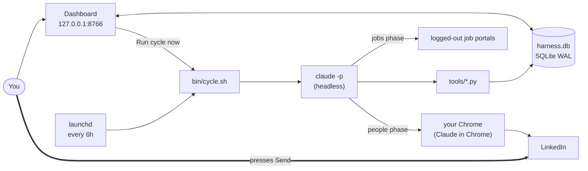

A local system that finds jobs, finds the right people at target companies, and prepares a LinkedIn note for each. **It never sends or submits anything: you press Send.** It runs only on your Mac, and the repo is private.

## Architecture

## Technology

| Layer | Implementation |
|---|---|
| Orchestration | `bin/cycle.sh` (bash), PID lock in `/tmp/jobsearch_cycle.lock` |
| Schedule | launchd: `StartInterval 21600`, `RunAtLoad false`; the dashboard agent is `KeepAlive` |
| AI worker | `claude -p <prompt> --permission-mode dontAsk --allowedTools <list> --max-budget-usd 3`; prompts in `docs/cycle_prompts/` |
| Browser | Claude in Chrome, in your own Chrome. Never Playwright, Selenium, Puppeteer or the `linkedin` MCP (those got accounts locked; a test enforces it) |
| Job sources | Logged-out TypeScript CLIs run with Bun (`.agents/skills/*-search/cli`) for LinkedIn, Freehire, and Wellfound; supervised Chrome for Naukri and Instahyre |
| Logic | Python in `tools/`: scoring, ranking, batching, control |
| State | One SQLite database, `harness.db` (schema in `schema.sql`) |
| UI | Python `ThreadingHTTPServer` plus static HTML, CSS and ES modules. No framework, no external requests |
| Agent API | FastMCP server, `harness/server.py`: locks, call budget, jobs, answers |
| Tests | pytest and `bun test`, run with `make test` |

## Job sources

| Source | Access | Method | Phase | Default |
|---|---|---|---|---|
| LinkedIn | Logged out | HTTP / Guest API via Bun CLI | Jobs | ON |
| Freehire | Logged out | HTTP API via Bun CLI | Jobs | ON |
| Wellfound | Logged out | HTTP via Bun CLI | Jobs | ON |
| Naukri | Supervised in Chrome | Claude in Chrome (read-only, user's browser) | Portals | OFF |
| Instahyre | Supervised in Chrome | Claude in Chrome (read-only, user's browser) | Portals | OFF |

Foreign job boards (Jobindex, Jobnet, Jobbank, Jobdanmark) have been removed from the pipeline.

## What changed recently

- **Simplified architecture:** Streamlined the cycle and dashboard into a single real-time status line directly reflecting the executing phase, without background event piping or step catalogs.
- **India portals:** Naukri and Instahyre are integrated into the supervised portals phase (default off, guarded by `ctl:portals`), running read-only in the user's Chrome session. Foreign boards have been completely removed.
- **Decision policy & submit control:** Single `ctl:submit` switch (0=Shadow, 1=Live), deterministic 4-outcome field classification (`tools/decide.py`), command injection immunity via JSON input, unified review dialog with company grouping, and pre-submit safety gate enforcing 25/day and 8/run caps.
- **First real run:** A live cycle executed on 2 Nov successfully generated `job_scraper/seen_jobs.json`.

## Where to go next

- [The Run cycle](/run-cycle/): what happens when you press the button.
- [Autonomy and decisions](/autonomy-and-decisions/): policy engine, review dialog, and safety gates.
- [Live progress](/live-progress/): real-time cycle status.
- [Daily use](/operations/) and [Known gaps](/gaps/).
