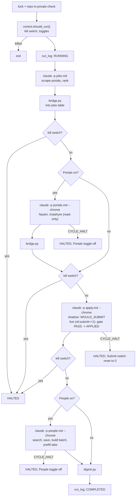

## When cycles start

Two ways, both ending in `bin/cycle.sh`:

| Trigger | Moves the schedule? |
|---|---|
| **Scheduled.** The dashboard process (always on via launchd, `KeepAlive`) runs a scheduler thread that checks every 30 s | Yes: next run = now + interval |
| **Run cycle now** (manual) | No. It is an extra run; the countdown is unchanged |

The schedule lives in the database (`budgets`: `ctl:interval_min`, default 360, and `ctl:next_due`, an epoch time from the **system clock**). The countdown ring shows `next_due − now`. When it reaches zero the scheduler starts a cycle and sets `next_due = now + interval`.

**Sleep and wake.** While the Mac is asleep nothing runs. On wake the scheduler's next tick sees `now ≥ next_due` and starts **one** catch-up cycle (not one per missed interval). A stale `RUNNING` row from a crash or power loss is marked `HALTED: interrupted` on the next tick. While a cycle runs, `caffeinate` stops idle sleep, but closing the lid still sleeps the Mac.

The launchd agent is now only a nudge: with `CYCLE_TRIGGER=launchd`, `cycle.sh` exits unless the database says a cycle is due, so the two never double-run.

## The click

`main.js` sends `POST /ctl/run_now` with your token in `X-Token`. The server checks the Host header and token, then calls `control.request_run_now()`:

- If the PID in `/tmp/jobsearch_cycle.lock` is alive, it returns `started: false` and the button says **Already running**.
- Otherwise it spawns `bin/cycle.sh` detached with `CYCLE_TRIGGER=dashboard` and returns `started: true` (**Started ✓**). Console output goes to `/tmp/jobsearch_cycle.log`.

## The cycle



### 1. Gate
Exits if another cycle holds the lock or the repo isn't private. `should_run()` reads the `budgets` keys `ctl:schedule`, `ctl:portals`, `ctl:people`, and the kill switch. A dashboard click skips only the schedule toggle.

### 2. Jobs phase
Claude follows `docs/cycle_prompts/jobs.md`: scrape logged-out portals (LinkedIn, Freehire, Wellfound, max 40 page loads) and rank with `rank_state.py`. Then `bridge.py` upserts ranked jobs into `jobs`, never downgrading `APPLIED` or `BLOCKED_USER`. Allowed tools: Read, Grep, Glob, Write, Edit, Skill, WebSearch and a named list of CLI commands. Nothing else.

### 3. Portals phase (default OFF)
Claude with `--chrome` follows `docs/cycle_prompts/portals.md`: reads the search plan from `query_plan.py` for Naukri and Instahyre in the user's Chrome (read-only, max 3 search pages and 5 detail JDs per portal), scores inline against the profile rubric, stores and applies with `rank_state.py`, and ingests via `bridge.py`. Any CAPTCHA or challenge immediately halts and turns `ctl:portals` off.

### 4. Applications phase
Runs as part of the scheduled cycle. Claude with `--chrome` follows `docs/cycle_prompts/apply.md`:
1. Selects ready candidates via `tools/decide.py next-jobs --limit 5 --run-id <RUN_ID>`.
2. For each job, opens the URL in Chrome and lets Simplify autofill first.
3. Audits and classifies all form fields via `tools/decide.py classify --input reports/cycle_work/<CYCLE>/field_<n>.json`.
4. If any field is `HARD_STOP`, parks as `BLOCKED_USER`. If `ESCALATE`, parks as `NEEDS_INPUT` and creates a pending row in `decisions` for the review dialog.
5. In **shadow** mode (`ctl:submit == 0`), stops before final submit, takes a screenshot if supported, and records `WOULD_SUBMIT`.
6. In **live** mode (`ctl:submit == 1`), checks `tools/decide.py gate --job <id> --run-id <RUN_ID>`. Clicks submit natively only if gate outputs PASS, then records `APPLIED`.
7. Enforces strict application caps: 25/day and 8/run. Any challenge or restriction stops the phase with `CYCLE_HALT:` and resets `ctl:submit` to 0.

### 5. People phase
Claude with `--chrome` follows `people.md` and `.claude/commands/network.md`:

1. `reachout_data.py`: who to skip.
2. `network_batch.py status`: today's cap.
3. LinkedIn people search at 2–4 companies (max 12 page loads).
4. `save_candidates.py`: score, drop executives, dedupe, store as `PROPOSED`.
5. `network_batch.py build --limit 7`.
6. Per person: open the profile, **Connect → Add a note**, type the note, **stop**. Then `mark PREFILLED`.

### 6. Wrap-up
`digest.py` writes `reports/digest-<date>.md`; `run_log` becomes `COMPLETED`.

## Job sources

| Source | Access | Method | Phase | Default |
|---|---|---|---|---|
| LinkedIn | Logged out | HTTP / Guest API via Bun CLI | Jobs | ON |
| Freehire | Logged out | HTTP API via Bun CLI | Jobs | ON |
| Wellfound | Logged out | HTTP via Bun CLI | Jobs | ON |
| Naukri | Supervised in Chrome | Claude in Chrome (read-only, user's browser) | Portals | OFF |
| Instahyre | Supervised in Chrome | Claude in Chrome (read-only, user's browser) | Portals | OFF |
| Applications | Supervised in Chrome | Claude in Chrome (Simplify-first, safety gate) | Apply | OFF |

Foreign job boards (Jobindex, Jobnet, Jobbank, Jobdanmark) have been removed from the pipeline.

## The watchdog

`run_claude()` runs `claude` in the background with direct output to per-phase log files, polling every second:

- Kill switch on → kills it and writes `CYCLE_HALT: kill switch pressed`.
- 1500 s elapsed → `CYCLE_HALT: phase timeout`.

After each phase the script greps the output for a `CYCLE_HALT:` line. A halt in the portals phase turns `ctl:portals` off, a halt in the apply phase resets `ctl:submit` to 0, and a halt in the people phase turns `ctl:people` off.

:::caution[A cycle never]
creates accounts, enters passwords, solves CAPTCHAs, submits live applications without passing the safety gate, contacts someone already contacted, or contacts VP/Director/CTO-level people.
:::

## What you can see while it runs

The dashboard provides real-time visibility through a clean header status line and log records:

| Item | Where it is visible |
|---|---|
| Active phase (`RUNNING: <phase>`) | Dashboard header status line |
| Cycle completion or halt | Dashboard header status line (`COMPLETED` or `HALTED: <reason>`) |
| Run history with status and halt reason | Library → Runs card |
| Full raw logs | `reports/cycle_logs/<run>.{log,jobs.out,portals.out,apply.out,people.out}` |

To watch the raw cycle log live in the terminal:

```bash
tail -f reports/cycle_logs/$(ls -t reports/cycle_logs | head -1)
```
